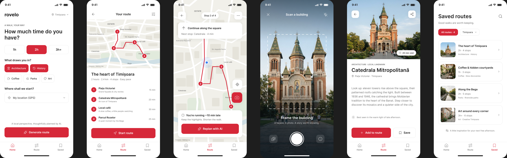

# Rovelo

AI-powered walking city guide that plans and adapts your route in any city.

> **Vibe-coded project.** Rovelo is built through *vibe coding*: most of the code is written
> together with an AI coding assistant (Claude), from my prompts, decisions and design.
> I define the product, the Figma design and the architecture, review every change and test
> each screen on a real phone before committing.

## How it works
- Pick how much time you have and what interests you
- An AI agent builds a walking route from OpenStreetMap data
- Navigate live; the agent replans if you run late
- Photograph a building to get its story

## What works today (mobile, with mock data)
The mobile UI is implemented end to end. The backend and the AI agent are not built yet, so
routes, replanning and landmark recognition return mock data from one place
(`mobile/src/services/agent.ts`), shaped like the future API responses.

- **Launch:** animated splash built from the app icon (steps walk in, the pin drops)
- **Auth:** Welcome, Log in, Create account, Continue as guest (simulated in memory);
  animated transition into the app (a red circle grows from your tap, shrinks into the Home tab)
- **Home / Preferences:** time (1h / 2h / 3h+), interests, starting point, *Generate route*
- **Your route:** map with the walking line and numbered stops, stop list with walk time
  between stops, total time and distance; routes can have any number of stops
- **Live navigation:**
  - GPS position on the map, *Stop X of N*, next-stop card with distance and direction
  - arrival detection (30 m), auto-continue when you leave a stop
  - progress kept when leaving the screen (*Resume route*)
  - demo mode that simulates the walk, to test without being in the city
- **Running late + Replan with AI:** detects when you fall behind the plan, proposes a
  shorter route (*Updated route: removed X, saved N min*) with Accept / Keep original
- **Scan a building:** full-screen camera or gallery → *Place story* with your photo,
  the story of the place, *Add to route*, *Save*, *Share*
- **Saved** (saved places) and **Profile** (account details, Log out)

### Design decisions so far
- The **order of stops is chosen by whoever creates the route**; the app keeps it and only
  computes the walk between stops.
- The map uses the **native map** (Google Maps on Android, Apple Maps on iOS) with a minimal
  light style; route data comes from OpenStreetMap through the backend.
- One red from the app icon (`#BF1C21`), all colors in `mobile/src/constants/theme.ts`.

## Tech stack
- **Mobile:** React Native with Expo (SDK 58), expo-router, TypeScript
  - react-native-maps, expo-location, expo-camera, Reanimated, Lucide icons
- **Backend (planned):** Spring Boot (Java), REST API, JWT auth
- **Database (planned):** PostgreSQL
- **AI (planned):** pre-trained model called through an API with tool calling
  (`search_places`, `build_route`, `get_current_location_context`, `recognize_landmark`,
  `save_trip`); the API key stays on the server
- **Maps data:** OpenStreetMap

## Project structure
- `mobile/`: React Native app
  - `src/app/`: screens (expo-router): `(auth)`, `(tabs)` with Home · Route · Saved · Profile, `scan`
  - `src/components/`: UI building blocks and the route map
  - `src/context/`: session (auth) and route state (active route, walk progress, saved places)
  - `src/services/agent.ts`: mock "agent" calls, to be replaced by backend calls
  - `src/data/mock.ts`: mock places and routes in Timișoara (the test city)
- `backend/`: Spring Boot server (not started yet)
- `docs/`: use case diagram, Figma exports, app icon

## Run it
```bash
cd mobile
npm install
npx expo start --tunnel
```
Scan the QR code with **Expo Go** (Android / iOS). Demo account: `demo@rovelo.app` /
`rovelo123`, or *Continue as guest*. Far from Timișoara? Start a route and tap
*Simulate walk*.

## Prototype
UI prototype designed in Figma:



## Status
Course project (PAAM, UPT).
- [x] Use case diagram and Figma prototype
- [x] Mobile UI with mock data (all main screens)
- [ ] Backend: auth (JWT), PostgreSQL, routes API
- [ ] AI agent with OpenStreetMap tools (route generation, replanning, landmark recognition)
- [ ] Social: share routes, *For you* / *Friends* feed